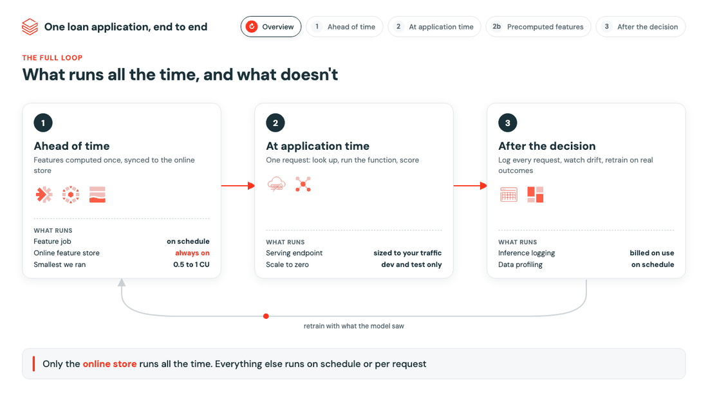

# Feature Store demo: one loan application, end to end

A credit-scoring flow on synthetic data that shows how Databricks Feature Store handles precomputed features,
application-time features, real-time serving, monitoring and the feedback loop to the next training set.

[](docs/architecture.html)

The image cycles through the parts of the architecture. **Interactive versions** (click a tab, or use the arrow keys):

- [Feature Store end to end](https://koritadenada.github.io/feature-store-credit-demo/architecture.html), serving on Databricks
- [Serving from your own infrastructure](https://koritadenada.github.io/feature-store-credit-demo/serving-own-infra.html): features and training in Databricks, published to DynamoDB, scored by your own Kubernetes service

Both are single HTML files in [`docs/`](docs/), so they also work offline.

## What gets built

Everything is created in one schema of a catalog you choose (default schema `credit_feature_store`), plus a few
workspace objects. All names can be changed with bundle variables.

| What | Name | Created by |
|---|---|---|
| Synthetic source data: customers, card/salary/instalment transactions, past applications with outcomes, mocked bureau scores | `customers`, `transactions`, `applications`, `bureau_scores` | step 1 |
| Feature table: 90-day aggregates per customer, weekly snapshots, primary key with a `TIMESERIES` column | `customer_features_90d` | step 2 |
| Online feature store (Lakebase) and the published copy of the feature table | `credit-demo-online-store`, `customer_features_90d_online` | step 3 |
| Request-time function in Unity Catalog | `debt_to_income` | step 4 |
| Model in Unity Catalog, logged with its features, alias `@champion`, plus the training data as monitoring baseline | `credit_risk_model`, `training_set_baseline` | step 5 |
| Model Serving endpoint with automatic feature lookup and an inference table | `credit-risk`, `credit_risk_payload` | step 6 |
| Scored applications with simulated outcomes, and two weeks of simulated traffic | `scored_applications`, `inference_history_backfill` | steps 7, 7b |
| Inference log (one row per application), data profiling monitor, its metric tables and dashboard | `inference_log`, `inference_log_profile_metrics`, `inference_log_drift_metrics`, dashboard "inference_log Monitoring" | step 8 |
| Next training set: what the model saw at decision time, plus the outcome | `next_training_set` | step 9 |
| Two jobs, four SQL alerts and a loan application app | `feature-store-credit-setup`, `feature-store-credit-feedback`, alerts "Credit risk: ...", `loan-scoring-app` | bundle deploy |

## Run it

You don't run the notebooks one by one: one job builds everything in order.

**Requirements:** the Databricks CLI, and a workspace with Unity Catalog, serverless compute, Model Serving, Lakebase
and Databricks Apps. You need permission to create a schema in the target catalog, and the ID of a SQL warehouse for
the alerts (`databricks warehouses list`).

```bash
# 1. Connect the CLI to your workspace, and set the two required variables once for this shell
databricks auth login --host <workspace-url> --profile <profile>
export BUNDLE_VAR_catalog=<catalog> BUNDLE_VAR_warehouse_id=<warehouse-id>

# 2. Deploy the jobs, alerts and app
databricks bundle deploy -t dev --profile <profile>

# 3. Build everything: steps 1 to 9 in order (about 1 to 1.5 hours)
databricks bundle run setup -t dev --profile <profile>

# 4. Start the loan application app
databricks bundle run loan_app -t dev --profile <profile>
```

Step 3 can also be started from the workspace: **Jobs & Pipelines**, open `[dev <you>] feature-store-credit-setup`
(development mode adds the prefix), **Run now**.
Most of the time is the serving endpoint starting up (step 6) and the inference table filling up: step 8 waits until
the endpoint's logged requests have arrived, which can take up to an hour.

After the first build, the `feature-store-credit-feedback` job reruns steps 8 and 9 to pick up new traffic. It has a
daily schedule that is paused in development mode; run it by hand with `databricks bundle run feedback -t dev --profile <profile>`.

**To explore a step,** open its notebook in the workspace (`Workspace/Users/<you>/.bundle/feature-store-credit-demo/dev/files/src/`) and run it cell by cell.
Each notebook has widgets for the catalog and schema at the top. Run the setup job once first, because each step
uses what the previous one created.

## What each step shows

| Step | Notebook | What it shows |
|---|---|---|
| 1 | `src/01_generate_data.py` | Synthetic customers, 7 months of transactions, 20,000 past applications with outcomes, mocked bureau scores |
| 2 | `src/02_feature_table.py` | One feature table in Unity Catalog: 90-day aggregates, weekly snapshots, primary key with a `TIMESERIES` column |
| 3 | `src/03_online_store.py` | Online feature store (Lakebase, smallest size `CU_1`), published in `TRIGGERED` mode |
| 4 | `src/04_function.py` | Request-time function in Unity Catalog: debt-to-income from request fields plus looked-up income |
| 5 | `src/05_train.py` | Point-in-time training set (`FeatureLookup` + `FeatureFunction`), model logged with `fe.log_model` |
| 6 | `src/06_serve.py` | Model Serving endpoint with automatic feature lookup and an inference table; the model returns the features it saw with every score |
| 7 | `src/07_score.py` | One application scored live, then a stream of 300 (a third of them shifted, so there is drift to find); the same applications scored with `score_batch` from the offline table give identical scores |
| 7b | `src/07b_backfill_history.py` | Simulated two weeks of traffic with growing drift, scored by the live endpoint with point-in-time features, so the dashboard shows a trend |
| 8 | `src/08_monitoring.py` | Inference table unpacked to one row per application; data profiling against the training baseline, with an auto-generated dashboard (adapted to a 0/1 prediction by `src/dashboard_fix.py`) |
| 9 | `src/09_next_training_set.py` | Logged requests joined with outcomes: the next training set matches what was known at decision time |
| 10 | `src/10_cost.py` | What the demo cost, from `system.billing.usage` and list prices (run it by hand; needs access to system tables) |

**Alerts** (`resources/alerts.yml`): four daily SQL alerts on the monitoring metrics, emailed to the person who
deployed the bundle: features drifted from training, decline rate moved, features missing at scoring time
(online/offline skew), fewer defaults caught.

**Loan application app** (`app/`, FastAPI and one HTML page): pick a customer, amount, term and channel; it scores the
application on the endpoint and shows the decision, what it was based on, and optionally the raw request and response.

## Variables

Set in `databricks.yml`; override with `--var name=value` or an environment variable `BUNDLE_VAR_<name>`:

| Variable | Default | |
|---|---|---|
| `catalog` | none, required | an existing catalog |
| `warehouse_id` | none, required | SQL warehouse for the alerts |
| `schema` | `credit_feature_store` | created if missing |
| `endpoint` | `credit-risk` | serving endpoint name |
| `online_store` | `credit-demo-online-store` | online feature store name |

## Cost notes

- The **online store runs all the time** and is the one component to keep small. Delete it when you are done.
- The endpoint uses **scale to zero**, which suits a demo. For production, size minimum concurrency to real traffic.
- Jobs, data profiling and the alerts only cost while they run.

## Clean up

The endpoint and the online store are created by the notebooks, so delete them first:

```python
from databricks.feature_engineering import FeatureEngineeringClient
from databricks.sdk import WorkspaceClient
w = WorkspaceClient()
w.serving_endpoints.delete("credit-risk")
w.feature_store.delete_online_table(online_table_name="<catalog>.credit_feature_store.customer_features_90d_online")
FeatureEngineeringClient().delete_online_store(name="credit-demo-online-store")
```

Then `databricks bundle destroy -t dev --profile <profile>` (jobs, alerts, app) and drop the schema.
